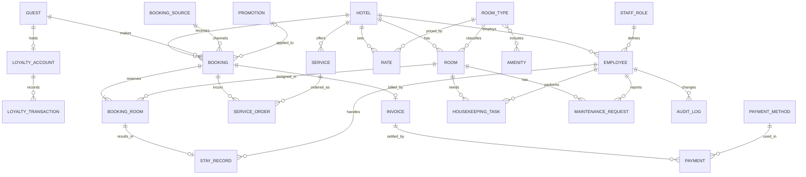

# Portfolio 1: Database Design and Modelling

**Case study:** The Homes Hotel Chain (simulated)
**DBMS:** PostgreSQL 15+
**Evidence files:** `schema.sql` (full DDL)

---

## 1. Case Study Description

The Homes is a simulated hotel chain operating several branches across multiple cities. Each branch has its own rooms, staff, and services, while guests, pricing policy, loyalty accounts, and reporting are managed chain-wide. Bookings arrive through the website, mobile app, front desk, and travel agents, and the system runs 24/7.

**Main processes:** search availability, reserve rooms, modify or cancel bookings, process deposits, payments and refunds, check-in and check-out, post service charges, issue invoices, housekeeping and maintenance, loyalty points, and management reporting.

**Why advanced database features are needed:** concurrent bookings of the same room require strict isolation and constraints; payments need atomic multi-step transactions; date-range availability queries need optimisation; reviews and logs suit a NoSQL model; and a multi-branch chain with 24/7 demand needs replication, sharding, and cloud deployment.

**Indicative scale:** 5 branches, about 600 rooms, 50,000+ guests, 200,000+ bookings, 1,000,000+ payment and invoice records, several million audit events.

---

## 2. Entity-Relationship Diagram

**Notable relationships**
- `ROOM_TYPE` to `AMENITY` is many-to-many, resolved by `room_type_amenity`.
- `BOOKING` to `ROOM` is many-to-many (a booking can include several rooms), resolved by `booking_room`.
- `GUEST` to `LOYALTY_ACCOUNT` is one-to-one, enforced with a `UNIQUE` foreign key.
- `PROMOTION` is optional on a booking.

---

## 3. Relational Schema (summary)

PK = primary key, FK = foreign key, UK = unique key.

| Table | PK | Foreign keys | Other keys |
|---|---|---|---|
| hotel | hotel_id | | UK email |
| room_type | room_type_id | | UK type_name |
| room | room_id | hotel_id, room_type_id | UK (hotel_id, room_number) |
| amenity | amenity_id | | UK amenity_name |
| room_type_amenity | (room_type_id, amenity_id) | both | |
| rate | rate_id | hotel_id, room_type_id | |
| promotion | promo_id | | UK promo_code |
| guest | guest_id | | UK email |
| loyalty_account | loyalty_id | guest_id | UK guest_id |
| loyalty_transaction | loyalty_txn_id | loyalty_id | |
| staff_role | role_id | | UK role_name |
| employee | employee_id | hotel_id, role_id | UK email |
| booking_source | source_id | | UK source_name |
| booking | booking_id | guest_id, hotel_id, source_id, promo_id | |
| booking_room | booking_room_id | booking_id, room_id | UK (booking_id, room_id) |
| stay_record | stay_id | booking_room_id, checkin_by, checkout_by | UK booking_room_id |
| service | service_id | hotel_id | UK (hotel_id, service_name) |
| service_order | order_id | booking_id, service_id | |
| invoice | invoice_id | booking_id | UK booking_id |
| payment_method | method_id | | UK method_name |
| payment | payment_id | invoice_id, method_id | |
| housekeeping_task | task_id | room_id, assigned_to | |
| maintenance_request | request_id | room_id, reported_by | |
| audit_log | audit_id | changed_by | |

---

## 4. Constraints

| Type | Examples |
|---|---|
| Entity integrity | Every table has a primary key |
| Referential integrity | All foreign keys above; `ON DELETE CASCADE` only from booking to booking_room |
| Domain / CHECK | `check_out_date > check_in_date`; `num_guests > 0`; room, booking, invoice, payment status lists; `nightly_rate > 0`; `discount_pct` between 0 and 100; `star_rating` between 1 and 5 |
| Uniqueness | Guest email, promo code, room number within a hotel |
| NOT NULL | All mandatory business attributes |
| **Exclusion constraint** | `EXCLUDE USING gist (room_id WITH =, stay_period WITH &&) WHERE (is_active)` makes it impossible for two active reservations to overlap on the same room, enforced by the database rather than application code |

Rules that cannot be expressed as simple constraints (guest count not exceeding room capacity, only available rooms assignable, deposit required before confirmation) are implemented later as triggers and stored procedures (Portfolios 2 and 3).

---

## 5. Normalisation Explanation

### Starting point (unnormalised)

A typical front-desk record might look like this:

`BookingID, GuestName, GuestEmail, GuestPhone, HotelName, HotelCity, Rooms (101, 102), RoomTypes (Double, Suite), RoomRates, Services (Spa, Laundry), PaymentMethods, PaymentAmounts`

**Problems:** repeating groups, update anomalies (a guest's phone number is repeated on every booking), insertion anomalies (a guest or room type cannot be stored before a booking exists), and deletion anomalies (deleting the only booking loses the guest).

### First Normal Form (1NF)
Remove repeating groups and multi-valued attributes: rooms, services, and payments move into their own rows and tables (`booking_room`, `service_order`, `payment`). All attributes are atomic.

### Second Normal Form (2NF)
Remove partial dependencies on part of a composite key. In `booking_room (booking_id, room_id, ...)`, room attributes (room number, type, floor) depend only on `room_id`, so they live in `room`. Booking attributes (guest, dates, status) depend only on `booking_id`, so they live in `booking`. Likewise, amenities depend on room type, not on the (room type, amenity) pair, so they are in `amenity`.

### Third Normal Form (3NF)
Remove transitive dependencies. Examples:
- `booking → guest_id → guest_name, email`: guest details are in `guest`.
- `room → room_type_id → type_name, max_occupancy`: type details are in `room_type`.
- `employee → role_id → role_name`: role details are in `staff_role`.
- `payment → method_id → method_name`: method details are in `payment_method`.
- `booking → source_id → commission_rate`: commission belongs to `booking_source`.

### Deliberate, documented exceptions

| Item | Reason |
|---|---|
| `booking_room.stay_period` copies the booking dates | Required so PostgreSQL can enforce the no-overlap exclusion constraint per room. Kept consistent by a trigger. |
| `booking_room.rate_applied`, `service_order.unit_price_charged` | Price snapshots: historical charges must not change when current rates or prices change. These are not redundant data. |
| `invoice.subtotal / tax_amount / total_amount` | Frozen financial record at issue time, required for audit and legal reasons even though they could be recomputed. |

Result: all tables are in 3NF, apart from the controlled exceptions above, which are justified by integrity and audit requirements.

---

## 6. Design Decisions and Trade-offs

- **Chain-wide guests, branch-specific rooms and staff:** a guest can stay at any branch with one profile and one loyalty account. The trade-off is that this makes sharding by hotel less straightforward, discussed in Portfolio 5.
- **Reviews and activity logs excluded from the relational model:** they are unstructured and high volume, so they are modelled in MongoDB in Portfolio 4.
- **No raw card numbers or full ID numbers stored:** only gateway tokens and masked references, for security and privacy compliance.
- **Surrogate integer keys:** simple, fast joins, stable under business changes.

---

## 7. Reflection placeholder
Faced challenges while creating the database using PostgreSQL

## 8. References and AI-use declaration
Used AI to troubleshoot PostgreSQL code 
