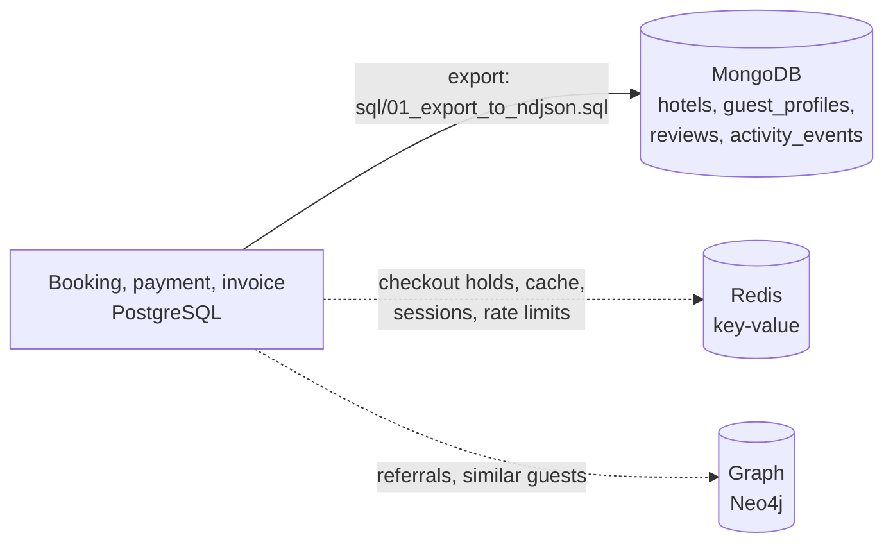

# Portfolio 4: NoSQL and Advanced Data Models

**Case study:** The Homes Hotel Chain
**Primary NoSQL model:** Document database (MongoDB 7 or 8)
**Supporting examples:** Key-value (Redis, optional) and graph (Neo4j Cypher, design sketch only)
**Builds on:** Portfolio 1 schema and the Portfolio 2 dataset in PostgreSQL

## 1. Purpose
Show which parts of the hotel system suit a NoSQL model, implement the best-fitting model in MongoDB with the same case study data, and explain when NoSQL beats the relational model and when it does not.

## 2. Polyglot architecture

PostgreSQL stays the system of record for money and reservations (ACID, constraints, Portfolios 1 to 3). The other stores hold data whose shape or access pattern the relational model handles less well.

## 3. What goes where
| Data | Best fit | Why |
|---|---|---|
| Bookings, rooms assigned, invoices, payments | **Relational** | Strict integrity, multi-table transactions, the exclusion constraint against double booking |
| Guest reviews | **Document** | Rating categories differ per review, optional hotel response, free text and tags, read as a whole |
| Guest profile and preferences | **Document** | Sparse, changing preferences; one read returns the whole profile |
| Hotel catalogue (rooms and services) | **Document** | A hotel is always read with its bounded list of rooms and services |
| Activity and IoT event log | **Document** | Different payload per event type, high write volume, queried by time |
| Room holds, availability cache, sessions, rate limits | **Key-value** | Tiny values, very fast, automatic expiry |
| Referrals and "guests like you" recommendations | **Graph** | Questions about relationships and paths of unknown length |

## 4. Document model (implemented)
| Collection | Documents | Embedded or referenced | Key design decisions |
|---|---|---|---|
| `hotels` | 5 | Rooms (120) and services embedded | Bounded arrays always read with the hotel |
| `guest_profiles` | 50,000 | Last 5 stays and a stay summary embedded; `preferences` is sparse | Read the whole profile in one lookup; the summary is pre-computed (a trade-off: it can go stale) |
| `reviews` | about 48,000 | `hotel_id`, `guest_id`, `booking_id` referenced; hotel name and guest display name copied in | Reviews are read per hotel without joins; old reviews keep the name used at the time |
| `activity_events` | about 146,000 | Payload embedded, shape depends on `type` | Append-only log, no joins, queried by hotel, type and time |

**Embed or reference?** Embed when data is read together and the array is bounded (rooms per hotel, five recent stays). Reference when data grows without limit or is shared (a guest's reviews are separate documents, not an ever-growing array inside the profile).

**Schema validation:** each collection has a `$jsonSchema` validator (`scripts/01_create_collections.js`), so flexible does not mean unchecked. Invalid reviews are rejected (demo C2).

### Example review document
```json
{ "_id": 22, "booking_id": 22, "hotel_id": 1, "hotel": "The Homes Abuja", "guest_id": 6118,
  "guest_display": "Otieno H.", "room_type": "Standard Single",
  "stay": { "check_in": "2023-04-09", "check_out": "2023-04-10", "nights": 1 },
  "posted_at": "2023-04-14T08:09:45Z",
  "rating": { "overall": 4, "cleanliness": 4, "service": 3, "location": 5, "value": 5 },
  "title": "Highly recommended",
  "comment": "The spa treatments were excellent. Parking was easy and secure.",
  "tags": ["spa", "parking"], "would_recommend": true, "helpful_votes": 22 }
```
Some reviews also have a `food` rating, a `trip_type` or a `hotel_response`; others do not. That variation is normal in a document database and would need nullable columns or extra tables in a relational design.

## 5. What I run
### 5.1 Install (once)
- **MongoDB Community Server** 7 or 8 (it installs and starts as a Windows service), plus **MongoDB Shell (mongosh)** and the **MongoDB Command Line Database Tools** (they provide `mongoimport`). All three are free downloads from mongodb.com.
- *Alternative:* a free **MongoDB Atlas** cluster. Set `MONGO_URI` to its connection string and use the same commands. MongoDB Compass can import the `.ndjson` files from its menu if `mongoimport` is a problem.
- In Git Bash, make the tools available (use your own folders and version numbers; find them in File Explorer):
```bash
export PATH="$PATH:/c/Program Files/MongoDB/Tools/100/bin"          # mongoimport
export PATH="$PATH:/c/Users/user/AppData/Local/Programs/mongosh"    # mongosh
export PATH="$PATH:/c/Program Files/PostgreSQL/18/bin"              # psql
export PGPASSWORD='your-postgres-password'
```
Check each with `mongosh --version`, `mongoimport --version` and `psql --version`.

### 5.2 Run (from the `portfolio-4-nosql` folder)
```bash
# 1. Export the PostgreSQL data as documents (about 30 seconds, writes about 120 MB into data/)
mkdir -p data
psql -U postgres -d the_homes -f sql/01_export_to_ndjson.sql

# 2. Create the collections with validation rules (do this BEFORE importing)
mongosh "mongodb://localhost:27017/the_homes_nosql" --file scripts/01_create_collections.js

# 3. Import the documents
bash scripts/02_import.sh

# 4. Indexes with before/after plans, queries, and CRUD/validation demos
mongosh "mongodb://localhost:27017/the_homes_nosql" --file scripts/03_indexes_explain.js > results/03_indexes_output.txt
mongosh "mongodb://localhost:27017/the_homes_nosql" --file scripts/04_queries.js        > results/04_queries_output.txt
mongosh "mongodb://localhost:27017/the_homes_nosql" --file scripts/05_crud_updates.js   > results/05_crud_output.txt
```
Run `03_indexes_explain.js` before `04_queries.js` (Q5 needs the text index, Q9 the `guest_id` index). The `data/*.ndjson` files are ignored by Git on purpose, because they are large and can be regenerated.

### 5.3 Optional key-value demo (Redis)
Needs `redis-cli` and a Redis server (Linux, WSL, Docker, or a free cloud instance with `REDIS_CLI="redis-cli -h HOST -p PORT -a PASSWORD"`):
```bash
bash redis/run_redis_demo.sh | tee results/06_redis_output.txt
```


## 6. Suitability analysis
| Aspect | PostgreSQL (relational) | MongoDB (document) | Verdict for The Homes |
|---|---|---|---|
| Money, bookings, stock | Constraints, foreign keys, The Homes needs more than one kind of database. PostgreSQL remains the system of record for bookings, invoices and payments, because those depend on guarantees shown in Portfolios 1 to 3: foreign keys, multi-table ACID transactions and the exclusion constraint that blocks double bookings. MongoDB does not offer these in the same way. Its transactions need a replica set and carry extra cost, and it has no foreign keys.

Other data fits documents better. Reviews are a good example. Their rating categories vary (only some include a food score), a hotel response is optional, and the text and tags are read together. In a relational design, this would need nullable columns or several extra tables. In MongoDB, the 48,084 reviews hold exactly the fields they need, and validation rules still reject bad data, as the rejected invalid review showed. Guest profiles are similar: preferences are sparse, so one lookup returns the whole profile instead of several joins.

The design uses both embedding and referencing. Rooms are embedded in each hotel document because they are bounded and always read together. Reviews are separate documents that reference the guest and hotel, because a guest’s reviews can grow without limit. The trade-off is duplicated data, such as copied hotel names and the pre-computed stay summary, which can go stale.

Indexing shows the model works at scale. Documents examined fell from 50,000 to 1 for an e-mail lookup, and from 146,031 to 135 for noise alerts, with times dropping from 196 ms to 4 ms. Indexes cost storage and slow writes, so they target known queries.

NoSQL would be the wrong choice for payments and room allocation, where correctness matters more than flexibility. Ad hoc reporting across entities is also easier in SQL. Redis suits temporary room holds and caches, and a graph database suits referral analysis, though the graph part here is only a design sketch.

## 9. Key-value and graph (supporting)
- **Key-value (Redis, `redis/run_redis_demo.sh`):** K1 temporary room hold with `SET NX EX`, K2 automatic expiry, K3 availability cache in a hash, K4 session, K5 rate limit, K6 spend leaderboard in a sorted set. Redis holds only temporary, rebuildable data; the booking itself is still written to PostgreSQL.
- **Graph (`graph/cypher_examples.cypher`):** design sketch only, **not executed**. It models guests, hotels and referrals and shows questions a graph answers naturally (similar guests, referral chains, shortest connection). If you run it in Neo4j, add your own screenshots and results, or state clearly that it is a design only.

## 7. Screenshot checklist (save in `screenshots/`)
- [ ] `01-export-counts.png`: row counts at the end of the PostgreSQL export
- [ ] `02-collections-created.png`: output of `01_create_collections.js`
- [ ] `03-import-counts.png`: the four "documents imported successfully" lines
- [ ] `05-indexes-before-after.png`: COLLSCAN against IXSCAN (I1 and I2)
- [ ] `06-queries-q3-q4.png` and `07-query-q5-text.png`, `08-query-q9-lookup.png`, `09-query-q10-flexible.png`

## 8. Reflection
The hardest part was the setup, not the queries. The MongoDB server installer did not include mongoimport, so I had to find and install the Database Tools separately, and then add each tool’s folder to the path in Git Bash. I also learned that order matters: the collections with validation rules had to exist before the import, and the indexes before the text-search query. Reading explain output was new to me. At first, the stage names were confusing, but comparing documents examined before and after made the effect of each index clear

## 9. AI-use declaration
I used AI assistance to draft the export script and the MongoDB scripts
