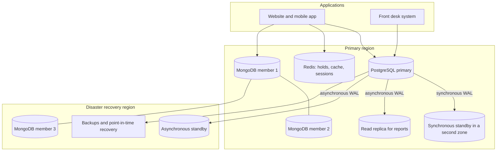

# Portfolio 5: Distributed and Cloud Database Exercise

**Case study:** The Homes Hotel Chain (branches in Abuja, Lagos, Port Harcourt, Accra, Nairobi)
**What is executed:** a MongoDB replica set and a MongoDB sharded cluster, both running on my own computer
**What is designed (not executed):** the cloud deployment and PostgreSQL replication
**Builds on:** Portfolio 4 (the documents are the `hotels`, `reviews`, `activity_events` and `guest_profiles` files it exported)

## 1. Purpose
A hotel chain must take bookings 24 hours a day from several countries. This portfolio shows, with evidence, how replication keeps the system available when a server fails, how consistency settings trade safety against speed, how sharding spreads data across servers and countries, and how this would be deployed in the cloud.

## 2. What is demonstrated
| Concept | Script | Evidence produced |
|---|---|---|
| Replication | `rs_03_replication_demo.js` | A write reaches all three members; the oplog entry that carried it |
| Availability and failover | `rs_04_failover_test.sh` | The primary is crashed while an application keeps writing; election time, blocked writes, no acknowledged write lost |
| Consistency trade-offs | `rs_05_consistency.js` | Cost of `w:1` against `w:majority`; a stale read from a secondary that is 5 seconds behind |
| CAP theorem | `rs_06_partition_cap.sh` | With the majority gone, the survivor refuses writes but serves reads |
| Sharding | `shard_03_configure.js`, `shard_05_distribution.js` | Documents per shard, hotels per shard, targeted against scatter-gather queries |
| Data locality | zone ranges in `shard_03_configure.js` | Nigerian hotels on shard 1, other countries on shard 2 |
| Cloud deployment | Sections 7 to 9 | Architecture diagram, availability targets, trade-off tables |

## 3. Lab layout (all on one computer)
```
Replica set "homesrs"        27018  27019  27020      (3 members: 1 primary, 2 secondaries)
Sharded cluster              27101 config server | 27102 shard 1 | 27103 shard 2 | 27200 mongos router
Your normal MongoDB service  27017                    (not touched)
```
This is a simulation of a distributed system: the servers are separate processes with separate data, but they share one machine and one network, so there is no real network delay or partition. Section 10 lists the limitations.

## 4. The Code I Run 
### 4.1 Prepare
I installed `mongod`, `mongos`, `mongosh` and `mongoimport` on my path. `mongod` and `mongos` are in the MongoDB **Server** folder (for example `/c/Program Files/MongoDB/Server/8.0/bin`).
```bash
export PATH="$PATH:/c/Program Files/MongoDB/Server/8.0/bin"            # mongod, mongos (use your version)
export PATH="$PATH:/c/Program Files/MongoDB/Tools/100/bin"             # mongoimport
export PATH="$PATH:/c/Users/user/AppData/Local/Programs/mongosh"       # mongosh
mongod --version; mongos --version; mongosh --version; mongoimport --version
```
The scripts load the Portfolio 4 files from `../portfolio-4-nosql/data`. If they are missing, re-run the Portfolio 4 export (`sql/01_export_to_ndjson.sql`) or set `export P4_DATA=/path/to/data`.
Windows may show a firewall prompt for `mongod`; allow private-network access. The lab needs about 2 GB of free disk space and 2 GB of memory. Keep this Git Bash window open while the servers run, and stop them with the `*_99_stop.sh` scripts when finished.

### 4.2 Part A: replica set (replication, failover, consistency, CAP)
```bash
bash scripts/rs_01_start.sh                       # start 3 servers
bash scripts/rs_02_initiate_and_seed.sh           # create the replica set and load hotels and reviews

URI="mongodb://127.0.0.1:27018,127.0.0.1:27019,127.0.0.1:27020/?replicaSet=homesrs"
mongosh "$URI" --file scripts/rs_03_replication_demo.js > results/03_replication_output.txt

bash scripts/rs_04_failover_test.sh | tee results/04_failover_output.txt      # about 1.5 minutes
mongosh "$URI" --file scripts/rs_05_consistency.js > results/05_consistency_output.txt
bash scripts/rs_06_partition_cap.sh | tee results/06_cap_output.txt           # about 1 minute

bash scripts/rs_99_stop.sh --clean                # stop the servers and delete their data
```
Run them in this order. `rs_05` and `rs_06` need all three members running (`rs_04` restarts the crashed one at the end).

### 4.3 Part B: sharded cluster
```bash
bash scripts/shard_01_start.sh
bash scripts/shard_02_init.sh
mongosh "mongodb://127.0.0.1:27200" --file scripts/shard_03_configure.js > results/shard_configure_output.txt
bash scripts/shard_04_import.sh                   # loads events and guest profiles through the router
mongosh "mongodb://127.0.0.1:27200" --file scripts/shard_05_distribution.js > results/shard_distribution_output.txt

bash scripts/shard_99_stop.sh --clean
```
Run Part A's stop script before starting Part B if your computer is short of memory.

## 5. What to expect
| Script | Expected result |
|---|---|
| `rs_03` | Three members (1 PRIMARY, 2 SECONDARY); the demo review is found on all three; one oplog entry with `op: "i"` |
| `rs_04` | Writes are blocked for roughly 10 to 15 seconds after the crash (the default election timeout is 10 s), a new primary is elected, `documents stored` equals `acknowledged`, the old primary returns as SECONDARY |
| `rs_05` | `w:1` is faster than `w:majority`, and `w:majority` with journal is slowest; the delayed secondary does **not** have the document immediately and has it 6.5 seconds later |
| `rs_06` | The survivor reports `isWritablePrimary: false`, the write is refused (`NotWritablePrimary`), the read still works; after recovery writes work again |
| `shard_05` | `activity_events` split roughly 60% and 40% between shards (hotels 1 to 3 on shard 1, hotels 4 and 5 on shard 2); `guest_profiles` split about 50% and 50%; `hotel_id` queries go to one shard, queries without the shard key go to both |

## 6. My results 
| Measurement | My value |
|---|---|
| Time writes were blocked during failover (the "blocked for" line) |14.5s |
| Acknowledged writes / documents stored | 184|
| `w:1`, `w:majority`, `w:majority` + journal: average ms per write |39.58 |
| Stale read: found immediately on delayed secondary? / after 6.5 s? |5s|
| Survivor behaviour with no majority (write result) |unexpected |
| `activity_events`: % on shard 1 / shard 2 |59.9%/40.1% |
| `guest_profiles`: % on shard 1 / shard 2 |49.2%/50.8% |

## 7. Target cloud architecture (design)

(The same diagram is saved in `diagrams/target_architecture.mmd`; paste it into mermaid.live to export an image. A second diagram, `sharding_zones.mmd`, shows the router, config servers and two zoned shards.)

| Component | Choice | Why | Trade-off |
|---|---|---|---|
| PostgreSQL (bookings, payments) | Primary plus a synchronous standby in another availability zone, an asynchronous replica for reports and another in a disaster-recovery region | No committed booking is lost if the primary fails; reporting does not slow bookings | Every COMMIT waits for the standby, and writes stall if it is down (`config/postgresql_replication_example.conf`) |
| MongoDB (reviews, profiles, events) | Three-member replica set across zones or regions, writes with `w: majority` | Automatic failover shown in `rs_04`; survives the loss of one member | Failover pause of seconds; cross-region members add latency |
| Redis | Managed instance with a replica | Room holds and sessions are temporary and can be rebuilt | Not the system of record |
| Backups | Daily full backup plus continuous WAL archiving, restores tested | Point-in-time recovery after human error or corruption | Replication does not protect against a bad `DELETE`, backups do |
| Security | Private network, TLS, encryption at rest, least-privilege roles, no public database ports | Guest identity and payment data | More set-up and key management |

**Managed or self-managed?** A managed service (a cloud PostgreSQL service, MongoDB Atlas) handles patching, backups and failover for a fee. Self-managed servers give more control and cost less per unit but need an experienced team. For a small IT team, I would choose managed services. Check which regions are closest to Nigeria and what each provider offers today before deciding; latency to West African users and data-protection rules (for example the data protection laws of Nigeria, Ghana and Kenya) both influence the region choice, and the current requirements should be verified.

## 8. Availability, recovery and consistency targets
| Data | RPO (data I can lose) | RTO (time to recover) | Approach |
|---|---|---|---|
| Bookings, invoices, payments | Zero | A few minutes | Synchronous standby plus automatic failover |
| Reviews and guest profiles | Seconds | A few minutes | Replica set with `w: majority` |
| Activity events | Minutes | Hours | Replicas and backups; can be partly rebuilt |
| Room holds, cache, sessions | Not needed | Seconds | Rebuilt from the databases |

**CAP and PACELC in this system.** During a network partition the system must choose between consistency and availability, and the choice differs by operation:
| Operation | Choice | Reason |
|---|---|---|
| Confirm a booking and take payment | Consistency | A double booking or lost payment is worse than a short pause (shown by `rs_06`) |
| Search room availability | Availability, slightly stale is acceptable | A cached count a few seconds old is fine; the booking step re-checks |
| Read reviews | Availability | A stale review does no harm (shown by `rs_05`) |
Even without a partition (PACELC), there is a latency price for consistency: `w:majority` was slower than `w:1` in `rs_05`.

## 9. Sharding strategy
| Candidate shard key | Cardinality | Targeted queries | Problem |
|---|---|---|---|
| `{ hotel_id }` alone | Only 5 values | Yes | The data cannot spread beyond 5 groups, and a busy hotel makes a hot spot |
| `{ hotel_id, ts }` **with zones (used)** | High | Yes for hotel and time queries | New events for a hotel always append to its newest chunk; the split between shards follows the number of hotels (3 against 2), so it is not even |
| Hashed `_id` **(used for guest profiles)** | Very high | Yes for lookups by id | Range queries and queries by e-mail go to every shard |
| `{ guest_id }` for reviews | High | Yes for a guest's reviews | Hotel dashboards would scatter across every shard |

Zones put each country's hotels on shards that could be located in that region, which helps latency and data residency, at the cost of an uneven split. Sharding is only worth its complexity at large scale: a few hundred thousand documents fit easily on one replica set, so the demonstration is about the design, not about need.

## 10. Limitations
- One computer: there is no real network latency, packet loss or partition. A crash is simulated by killing the process.
- Shards and the config server have one member each; production would use three-member replica sets for each.
- The data is small and simulated.
- PostgreSQL replication and the cloud deployment are designs and diagrams, not running systems.
- Failover time depends on MongoDB's default settings (election timeout 10 seconds); tuned production clusters may behave differently.

## 11. Screenshot checklist (save in `screenshots/`)
- [ ] `01-rs-members.png`: R1 and R3 from the replication demo
- [ ] `02-oplog-entry.png`: R4
- [ ] `03-failover-timeline.png`: the crash, "blocked for", the new primary
- [ ] `04-failover-verification.png`: acknowledged = stored, "no acknowledged write was lost"
- [ ] `05-write-concern-timings.png`: S1
- [ ] `06-stale-read.png`: S2 (not found, then found)
- [ ] `07-cap-refused-write.png`: P3
- [ ] `08-shard-distribution.png`: D1 and D2
- [ ] `09-shard-routing.png`: D4
- [ ] `10-architecture-diagram.png`: exported image of the cloud design
- [ ] Optional: a free MongoDB Atlas cluster overview showing its three replica set nodes (cloud evidence)

## 12. Analysis
Replication and failover. Writes to the primary reached both secondaries through the oplog, so every member held the same data. When the primary was crashed during the failover test, writes were blocked for 14.5 seconds while the remaining members held an election, matching MongoDB’s 10-second default timeout. A new primary took over, all 184 acknowledged writes were still stored with no gaps, and the old primary rejoined as a secondary.

Consistency. Writes with w:1 averaged 39.58 ms for w:majority, so safety has a measurable cost. A secondary held 5 seconds behind did not have a new document immediately but had it 6.5 seconds later, showing eventual consistency.

CAP. With two of three members removed, the survivor refused writes but still served reads. For bookings, this choice is correct, because a short outage is better than a double booking or lost payment. Searching availability or reading reviews can tolerate staleness.

Sharding. Activity events were sharded on hotel and time with zones, placing the Nigerian hotels on one shard and the others on the second. This favours data locality over balance: the split was 59.9% and 40.1%. Guest profiles used a hashed key and divided about evenly 49.2% and 50.8%. Queries with hotel_id reached one shard, while queries without a shard key reached every shard.


## 13. Reflection
Cloud design. I would use a synchronous PostgreSQL standby for bookings, a MongoDB replica set across zones, and managed services, accepting extra latency and cost.

Limitations. Everything ran on one computer, so there was no real network delay or partition.

## 14. AI-use declaration
Claude AI helped draft the procedures and I checked it against my own results.